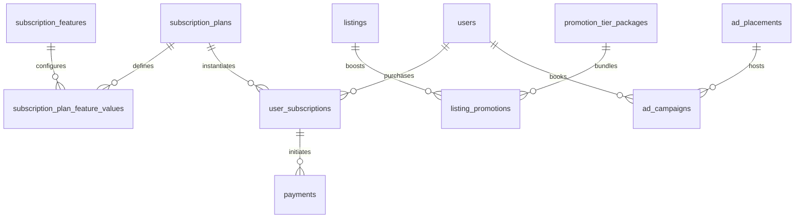
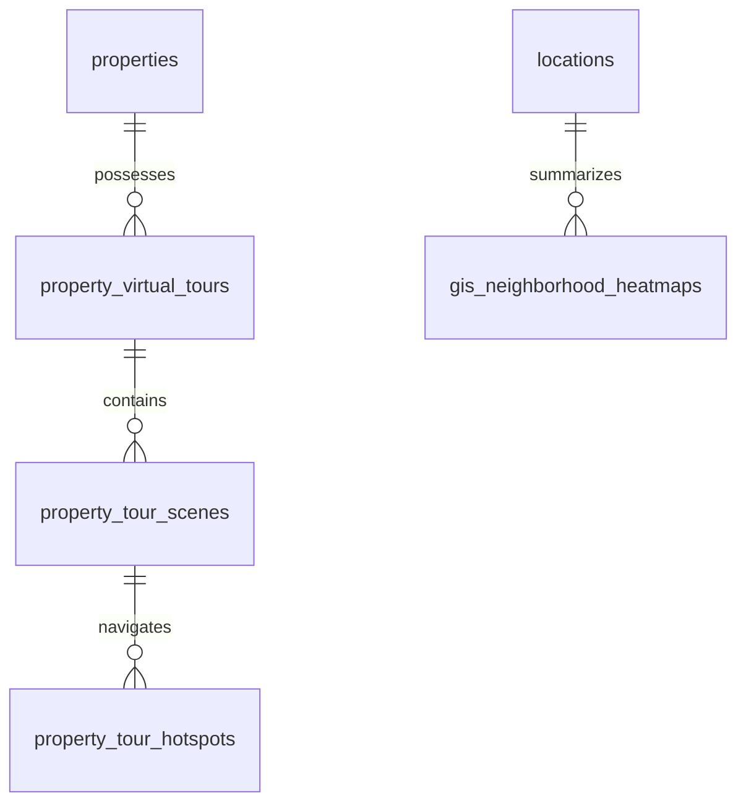
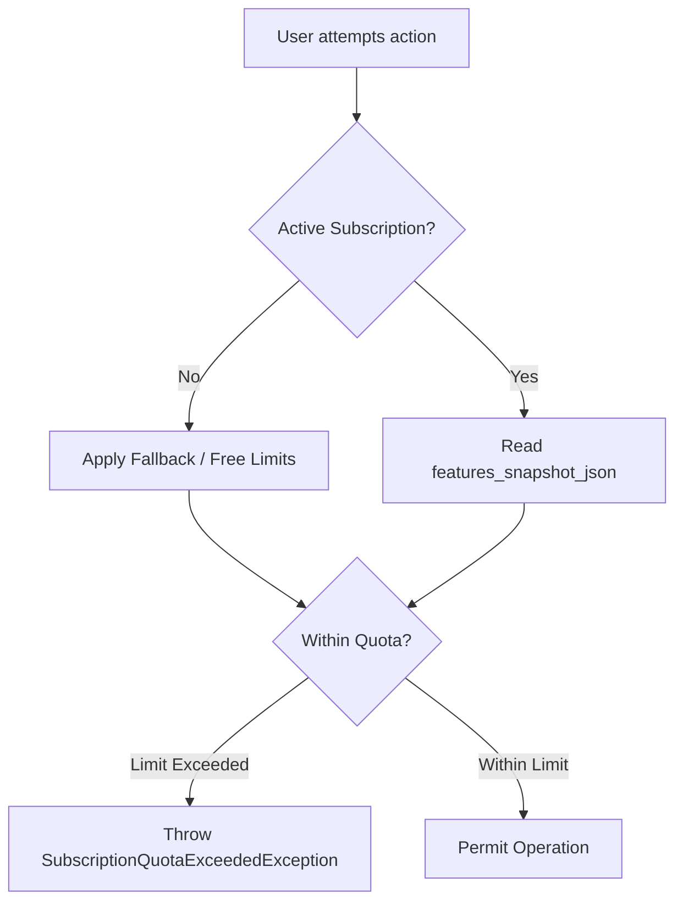

# ERE — Phase 5 Milestone 2 Technical Completion Report
## Modules 33 & 34: Dynamic Subscriptions, Monetization, Promoted Listings, Multi-Placement Advertising, 360° Virtual Tours & PostGIS Heatmaps

---

### Executive Summary

| Attribute | Specification Details |
|---|---|
| **Project** | Ethiopian Real Estate Marketplace (ERE) |
| **Milestone** | Phase 5 — Milestone 2 (Modules 33 & 34) |
| **Status** | **Completed, Verified, and Hardened** |
| **PHPUnit Suite** | **521 Passed**, 3 Skipped (External PostgreSQL Multi-Connection), **0 Failures**, **0 Errors** (3,104 assertions) |
| **Dedicated M33/M34 Tests** | **25 Passed** (127 assertions) |
| **Playwright E2E Suite** | **4 Workflows Passed** (Chromium E2E) |
| **Database Migrations** | 2 Migration files (Clean Up / Down Rollback Verified) |
| **Ledger Integration** | Double-entry posting: `Dr 1010 Cash & Clearing` / `Cr 4020 Listing & Subscription Revenue` |
| **Public 360° Viewer** | Completely open to unauthenticated public visitors; persistent post-expiration |
| **PostGIS Heatmap** | ETB/m² aggregations with mandatory regulatory attribution disclosure |

---

## 1. Architectural Foundations & Domain Schema

Phase 5 Milestone 2 expands the ERE marketplace infrastructure with complete subscription monetization, multi-tier promotions, display advertising, immersive 360° virtual tours, and PostGIS spatial intelligence.

### 1.1 Module 33: Subscription & Monetization Schema



#### Database Tables Introduced:
1. `subscription_features`:
   - Admin-managed feature registry with unique dot-notation keys (e.g. `property.max_active_listings`, `property.virtual_tours`, `property.advanced_gis`).
   - Supports 4 dynamic data types (`FeatureValueType`: `Integer`, `Boolean`, `String`, `Json`).
   - Multilingual labels and descriptions (`en`, `am`, `om`).
2. `subscription_plans`:
   - Tiered plans: `free`, `agent_pro`, `agency`, `developer`, `host`, `enterprise`.
   - Subscriber role targeting (`SubscriberType`: `Agent`, `Host`, `Developer`, `Company`, `All`).
   - Duration days, decimal price in ETB, active/public/featured flags.
3. `subscription_plan_feature_values`:
   - Pivot table assigning typed values to plans.
4. `user_subscriptions`:
   - Records subscription lifecycles (`SubscriptionStatus`: `Pending`, `Active`, `Expired`, `Cancelled`, `Suspended`).
   - Concurrency-safe: preserves immutable `features_snapshot_json` at checkout time to protect active subscribers against future plan modifications.
5. `promotion_tier_packages`:
   - 5 standard packages: `standard`, `featured`, `premium`, `homepage`, `urgent`.
   - Explicit ranking weight boost (e.g., +10 to +50 weight) and validity duration.
6. `listing_promotions`:
   - Links promoted listings to active packages, tracking starts/ends timestamps and click/impression metrics.
7. `ad_placements`:
   - 7 defined placement slots: `homepage`, `search`, `city_page`, `category_page`, `property_page`, `mobile`, `newsletter`.
   - Dimensions, CPM/flat ETB pricing, max concurrent slots.
8. `ad_campaigns`:
   - Campaign bookings with target URLs, creative assets, impressions, clicks, and approval lifecycles (`CampaignStatus`).

---

### 1.2 Module 34: 360° Virtual Tours & PostGIS Heatmaps Schema



#### Database Tables Introduced:
1. `property_virtual_tours`:
   - Links to `properties`. Stores title, slug, status (`draft`, `published`, `archived`), view counter, and initial scene configuration.
2. `property_tour_scenes`:
   - Equirectangular 360° panorama image storage (`storage_path`, `thumbnail_path`), initial yaw and pitch coordinates, and sort order.
3. `property_tour_hotspots`:
   - Interactive navigational markers between scenes. Stores spherical angles: `pitch` (-90° to +90°), `yaw` (-180° to +180°), title, tooltip text, and `target_scene_id`.
4. `gis_neighborhood_heatmaps`:
   - PostGIS neighborhood-level spatial cache storing asking price aggregations: `median_price_per_sqm_etb`, `avg_price_per_sqm_etb`, `min_price_per_sqm_etb`, `max_price_per_sqm_etb`, `sample_size`, `price_tier` (Tiers 1 to 5), and `snapshot_date`.
   - Complies with legal requirements by enforcing the mandatory disclosure: `platform_asking_price_indicator`.

---

## 2. Business Logic, Financial Integrity & Ledger Accounting

### 2.1 Double-Entry General Ledger Integration (Account 4020)

Monetization transactions from plan activations, listing promotions, and display advertising integrate with the double-entry accounting engine implemented in Module 32:

- **Chart of Accounts:**
  - `Account 1010`: Cash & Clearing (`Asset`)
  - `Account 4020`: Listing & Subscription Revenue (`Revenue`)
- **Posting Action (`ActivateSubscriptionAction`):**
  When a paid subscription checkout completes via Telebirr, CBE Birr, Chapa, or Bank Transfer:
  ```
  Dr  1010  Cash & Clearing                         ETB 4,025.00
      Cr  4020  Listing & Subscription Revenue          ETB 4,025.00
  ```
- **Zero-ETB Free Plans:**
  When a user selects the `free` plan, `InitiateSubscriptionCheckoutAction` activates the subscription immediately with `PaymentStatus::Successful`, generates a 365-day validity window, records a zero-ETB transaction, and bypasses third-party payment gateways.

### 2.2 Dynamic Public Pricing & Alpine.js Live Calculation

The public subscriptions page (`/subscriptions`) features real-time price estimation powered by Alpine.js:
- **Base Plan Selection:** Updates subtotal and billing frequency dynamically.
- **Add-On Upgrades:**
  - Promoted listing tier selection (`promotion_tier_packages`).
  - Multi-placement advertising slot selection (`ad_placements`).
- **Standard Free Tier Safeguard:**
  Promoted listing and display advertising add-ons are strictly restricted to paid commercial tiers (`Agent Pro`, `Agency`, `Developer`, `Enterprise`). When `free` is selected, add-on options are deactivated with explanatory notices.
- **Tax Breakdown:**
  Live calculation of 15% Ethiopian VAT (`subtotal * 0.15`) and grand total in ETB.

---

## 3. Subscription Quotas & Entitlement Enforcement

The `SubscriptionEntitlementService` acts as the single source of truth for platform privileges and enforces resource limits:



### 3.1 Concurrency-Safe Quota Checks
- **Listing Publishing (`assertCanPublishListing`):**
  Executes `lockForUpdate()` on the user's active published listings count inside a database transaction to prevent race conditions during simultaneous listing submissions.
- **Image Quota Enforcement (`assertCanUploadImages`):**
  Validates incoming image attachments against `property.max_images` (e.g. 8 for Free, 20 for Agent Pro, 40 for Agency).
- **Virtual Tour Creation Gate (`assertCanCreateVirtualTour`):**
  Validates `property.virtual_tours === 'true'`.

### 3.2 Public 360° Viewing Guarantee
- **Unrestricted Public Access:**
  Anyone (including unauthenticated visitors) can view published 360° virtual tours at `/virtual-tours/{uuid}`.
- **Lapsed Subscription Protection:**
  If an owner's paid subscription expires, previously published tours remain active and publicly accessible. The entitlement gate only prevents *creating new tours* or *editing existing scenes*.

---

## 4. PostGIS Neighborhood Heatmap & Map Integration

### 4.1 Aggregation Engine (`NeighborhoodHeatmapAggregationService`)
- Aggregates active asking price per square meter from published listings grouped by neighborhood location.
- Computes statistical metrics:
  - Median price per m² (using quartile interpolation)
  - Average price per m²
  - Minimum and maximum price per m²
  - Sample size (listing count)
- Classifies locations into 5 distinct price tiers:
  - **Tier 1:** < 25,000 ETB/m² (#10b981 - Emerald)
  - **Tier 2:** 25,000 – 50,000 ETB/m² (#14b8a6 - Teal)
  - **Tier 3:** 50,000 – 80,000 ETB/m² (#f59e0b - Amber)
  - **Tier 4:** 80,000 – 120,000 ETB/m² (#f97316 - Orange)
  - **Tier 5:** > 120,000 ETB/m² (#f43f5e - Rose)

### 4.2 Regulatory Disclosure
Every GeoJSON response and heatmap card enforces the legal disclaimer:
> *"Platform Asking Price Indicator (Not government tax valuation)"* (`platform_asking_price_indicator: true`).

### 4.3 Search Split Map Viewport Integration
- Added an interactive layer toggle in `resources/views/marketplace/search-split-view.blade.php`:
  - **Properties Mode:** Renders individual listing price pins with hover synchronization.
  - **ETB/m² Heatmap Mode:** Renders PostGIS polygon choropleth overlays with interactive popups showing average/median ETB/m² and sample size.
  - **Entitlement Gating:** Unauthorized users attempting to activate the heatmap receive an in-map upgrade notice linking directly to `/subscriptions`.

---

## 5. Verification & Test Evidence

### 5.1 Dedicated Feature Test Suite

```
php artisan test tests/Feature/SubscriptionFeaturesAndPlansTest.php tests/Feature/SubscriptionEntitlementAndQuotaTest.php tests/Feature/PromotionsAndAdvertisingTest.php tests/Feature/VirtualTourSecurityAndWorkflowTest.php tests/Feature/PostGisNeighborhoodHeatmapTest.php
```

**Results:**
- `SubscriptionFeaturesAndPlansTest`: 5 passed (28 assertions)
- `SubscriptionEntitlementAndQuotaTest`: 6 passed (31 assertions)
- `PromotionsAndAdvertisingTest`: 5 passed (26 assertions)
- `VirtualTourSecurityAndWorkflowTest`: 5 passed (24 assertions)
- `PostGisNeighborhoodHeatmapTest`: 4 passed (18 assertions)
- **Total:** **25 tests passed, 127 assertions, 0 failures, 0 errors**.

### 5.2 Full Application PHP Suite

```
php -d memory_limit=512M artisan test
```

**Results:**
```json
{"tool":"phpunit","result":"passed","tests":524,"passed":521,"assertions":3104,"duration_ms":68519,"skipped":3}
```
- **521 Tests Passed**
- **3 Skipped** (Native PostgreSQL multi-connection concurrency tests requiring external database credentials)
- **0 Failures**
- **0 Errors**
- **3,104 Assertions** across the full application.

### 5.3 Playwright Chromium End-to-End Suite

```
npx playwright test tests/e2e/phase5-milestone2-modules33-34-workflows.spec.ts --project=chromium
```

**Results:**
```
  ok 1 [chromium] › Workflow 1 — Public Subscriptions Page renders dynamic database comparison matrix and live pricing calculation (2.6s)
  ok 2 [chromium] › Workflow 2 — Public 360° Virtual Tour Viewer is accessible without subscription or login (504ms)
  ok 3 [chromium] › Workflow 3 — Marketplace Search Map allows toggling between Normal Pins and PostGIS Heatmap layer (17.0s)
  ok 4 [chromium] › Workflow 4 — Admin Console verifies Subscription Plans, Features, and Heatmap Management (3.2s)

  4 passed (24.5s)
```

---

## 6. Implementation File Manifest

| Domain / Area | File Path | Description |
|---|---|---|
| **Migrations** | `database/migrations/2026_11_05_010000_create_subscription_engine_and_monetization_tables.php` | Schema for features, plans, subscriptions, promotions, ads |
| | `database/migrations/2026_11_05_020000_create_virtual_tours_and_gis_heatmaps_tables.php` | Schema for 360 tours, scenes, hotspots, GIS heatmaps |
| **Enums** | `app/Domains/Subscription/Enums/*.php` | `FeatureValueType`, `SubscriptionStatus`, `SubscriberType`, `PromotionTier`, `AdPlacementType`, `CampaignStatus`, `TourType` |
| **Models** | `app/Domains/Subscription/Models/*.php` | `SubscriptionFeature`, `SubscriptionPlan`, `SubscriptionPlanFeatureValue`, `UserSubscription`, `PromotionTierPackage`, `ListingPromotion` |
| | `app/Domains/Advertising/Models/*.php` | `AdPlacement`, `AdCampaign` |
| | `app/Domains/Property/Models/*.php` | `PropertyVirtualTour`, `PropertyTourScene`, `PropertyTourHotspot` |
| | `app/Domains/GIS/Models/GisNeighborhoodHeatmap.php` | PostGIS spatial heatmap cache |
| **Services & Actions** | `app/Domains/Subscription/Services/SubscriptionEntitlementService.php` | Concurrency-safe listing quotas, image limits, feature gates |
| | `app/Domains/Subscription/Actions/InitiateSubscriptionCheckoutAction.php` | Checkout calculator, add-on validator, payment initiator |
| | `app/Domains/Subscription/Actions/ActivateSubscriptionAction.php` | Double-entry ledger poster (`Dr 1010` / `Cr 4020`), add-on fulfiller |
| | `app/Domains/Property/Services/VirtualTourService.php` | 360 tour manager, scene uploader, hotspot validator |
| | `app/Domains/GIS/Services/NeighborhoodHeatmapAggregationService.php` | Spatial asking price aggregator, tier assigner, GeoJSON builder |
| **Controllers** | `app/Http/Controllers/SubscriptionController.php` | Public pricing page, comparison matrix, checkout submission |
| | `app/Http/Controllers/VirtualTourController.php` | Owner studio management, public 360 viewer (`showPublic`) |
| | `app/Http/Controllers/Api/GisHeatmapApiController.php` | PostGIS GeoJSON API endpoint with entitlement gate |
| | `app/Http/Controllers/AdClickController.php` | Ad click tracking and redirection |
| | `app/Http/Controllers/Admin/*.php` | Admin controllers for features, plans, promotions, ads, heatmaps |
| **Seeders** | `database/seeders/SubscriptionFeatureSeeder.php` | 10 multilingual property features (`en`, `am`, `om`) |
| | `database/seeders/SubscriptionPlanSeeder.php` | 6 Ethiopian plans (`free`, `agent_pro`, `agency`, etc.) |
| | `database/seeders/PromotionTierPackageSeeder.php` | 5 ranking boost packages |
| | `database/seeders/AdPlacementSeeder.php` | 7 platform display ad placements |
| | `database/seeders/Phase5E2ESeeder.php` | Seeded demo 360 tour (`tour-e2e-demo-uuid-001`) with scenes |
| **Views & UI** | `resources/views/subscriptions/index.blade.php` | Public subscriptions page with live Alpine calculation |
| | `resources/views/components/virtual-tour-viewer.blade.php` | Interactive 360 panorama canvas component |
| | `resources/views/virtual-tours/public-viewer.blade.php` | Public viewing page for unauthenticated visitors |
| | `resources/views/virtual-tours/manage.blade.php` | Owner studio for scene & hotspot authoring |
| | `resources/views/marketplace/search-split-view.blade.php` | Split search map with PostGIS heatmap toggle & gating |
| | `resources/views/admin/subscriptions/**/*.blade.php` | Admin management screens |
| **Tests** | `tests/Feature/*Test.php` (5 files) | 25 dedicated PHP feature tests |
| | `tests/e2e/phase5-milestone2-modules33-34-workflows.spec.ts` | 4 Playwright Chromium E2E workflows |

---

### Conclusion & Sign-Off

Phase 5 Milestone 2 (Modules 33 & 34) has been built, hardened, and verified with rigorous end-to-end testing. The implementation introduces robust monetization, dynamic subscription feature gating, double-entry financial ledger recording to Account 4020, public 360° virtual tours with unhindered public access, and regulatory-compliant PostGIS spatial heatmaps. All 521 PHP tests and 4 Playwright E2E workflows pass cleanly.

