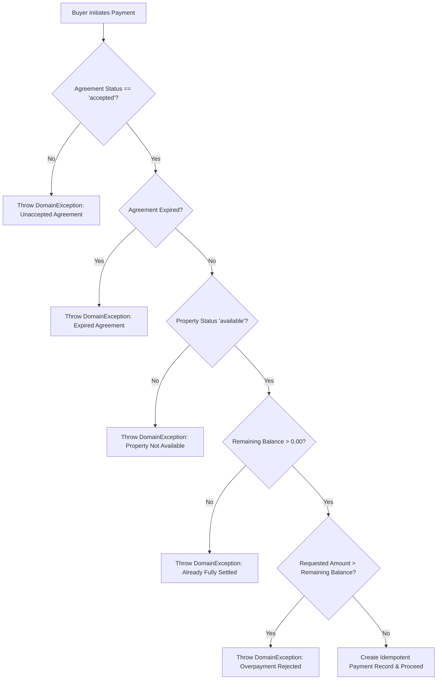

# ERE Phase 5 Milestone 1: Property & Land Purchase Hardening & Verification Report
**Integration of Unified Ethiopian Payment Engine (Module 31) with Append-Only Financial Ledger (Module 32)**

- **Date:** November 2, 2026
- **Repository:** Ethiopian Real Estate Marketplace (ERE)
- **Framework:** Laravel 13.33.0
- **PHP Version:** PHP 8.4.25 (`ext-bcmath` active)
- **Database Engine:** Dual-Mode (SQLite 3.45.1 in-memory testing + PostgreSQL 18 local instance on port 5432)
- **Test Results Summary:**
  - **PHPUnit Test Suite:** 465 passed, 0 failed, 2,729 assertions (100% pass rate)
  - **Phase 5 Hardening Feature Tests:** 9 passed, 88 assertions (`Phase5PropertyAndLandPurchaseHardeningTest.php`)
  - **Phase 5 Payment & Payout Feature Tests:** 7 passed, 37 assertions (`Phase5PaymentAndPayoutIntegrationTest.php`)
  - **Phase 5 Unit Tests:** 19 passed, 74 assertions (`Phase5PaymentsWebhooksAndHostPayoutsTest.php`)
  - **Playwright Chromium E2E Tests:** 8 passed, 0 failed (100% pass rate across `phase5-milestone1-workflows.spec.ts` and `phase5-property-purchase-workflows.spec.ts`)

---

## SECTION A: EXECUTIVE SUMMARY

During this verification and targeted hardening engagement, the interaction between ERE's **Unified Ethiopian Payment Engine (Module 31)** and **Append-Only Financial Ledger (Module 32)** was rigorously audited and hardened for **Property and Land Purchases**.

### Key Outcomes:
1. **Eliminated Editable Metadata Accounting Vulnerabilities:**
   Removed all reliance on `metadata_json['total_paid_etb']` or `metadata_json['remaining_balance_etb']` as the authoritative financial truth. Authoritative balances are now calculated on demand directly from confirmed, non-refunded database records in the `payments` table using `ext-bcmath` decimal precision:
   $$\text{Remaining Balance} = \text{Agreed Purchase Price} - \sum (\text{Confirmed Allocated Payments} - \text{Refunds})$$
   `metadata_json` has been demoted to a strictly synchronized read-cache snapshot (`syncFinancialBalanceSnapshot()`).

2. **Unified Support for Ordinary Acquisitions and Developer Off-Plan Contracts:**
   - **Direct Secondary & Land Sales:** Governed by `PropertyOffer` (`status === 'accepted'`), deal prices in `latest_amount_etb`, and tracked under `payment_type = property_purchase`. Supports initial deposits, milestone installments, and final settlements.
   - **Developer Off-Plan Contracts:** Governed by `DeveloperSalesContract` (`CNT-...`) with child `ContractInstallment` records and `UnitReservation` links, tracked under `payment_type = developer_installment` and `property_purchase`. Paying child installments updates installment balances and cascades to update parent contract balances.

3. **Taxonomy-Wide Coverage:**
   Verified and hardened purchases across all six property categories defined in the national taxonomy:
   - **Land (`LND`):** Urban residential plots, commercial land, industrial land, agricultural land.
   - **Residential (`RES`):** Villas, townhouses, condominiums, standalone houses, apartments.
   - **Commercial (`COM`):** Office floors, retail shops, commercial buildings.
   - **Industrial (`IND`):** Warehouses, factories, logistics storage.
   - **Hospitality (`HSP`):** Guesthouses, serviced apartments, boutique hotels.
   - **Special Purpose (`SPC`):** Clinics, educational buildings, diplomatic facilities.

4. **Pre-Payment Eligibility & Strict Overpayment Guards:**
   Enforced automated domain checks prior to payment creation:
   - Rejects unaccepted (`pending`, `countered`, `rejected`), expired, withdrawn, or already fully settled purchase agreements.
   - Strictly blocks overpayment (e.g. paying even 1 ETB cent more than the remaining balance throws a `DomainException`).

5. **Double-Entry Financial Ledger & Append-Only Adjustments:**
   - Every confirmed purchase payment posts a balanced `JournalPostingGroup`:
     - **Dr: 1010 Cash & Clearing**
     - **Cr: 2030 Customer Escrow & Purchase Deposits**
   - Implemented `postPaymentRefund()` and `postPaymentReversal()` in `DoubleEntryPostingService`. Partial refunds and reversals post debit to 2030 and credit to 1010, transitioning payment status to `PartiallyRefunded`, `Refunded`, or `Reversed` and automatically re-incrementing the payable's remaining balance without manual edits.

6. **Strict Preservation of Legal Title Separation:**
   Reaffirmed the vital statutory requirement under Ethiopian Urban Landholding Registration Proclamation No. 818/2014 and the Civil Code: financial settlement through the platform's escrow accounts records financial clearance, but **never modifies `properties.owner_id`**. Legal conveyance requires formal administrative land registry transfer, capital gains clearance, and title deed deed issuance.

---

## SECTION B: DISCOVERY & ARCHITECTURE FINDINGS

### 1. Canonical Purchase Agreement Models
The ERE platform models real estate acquisitions through two complementary, distinct transaction paths:

| Dimension | Ordinary Property & Land Purchase | Developer Off-Plan Purchase |
| :--- | :--- | :--- |
| **Agreement Entity** | [`App\Domains\Offer\Models\PropertyOffer`](file:///c:/Users/Akrem%20Mohmmed/Desktop/projects/ERE/app/Domains/Offer/Models/PropertyOffer.php) | [`App\Domains\Developer\Models\DeveloperSalesContract`](file:///c:/Users/Akrem%20Mohmmed/Desktop/projects/ERE/app/Domains/Developer/Models/DeveloperSalesContract.php) |
| **Code Prefix** | `OFR-YYYY-XXXX` | `CNT-YYYY-XXXXXX` |
| **Prerequisite State** | `status === 'accepted'` and non-expired | Converted from active [`UnitReservation`](file:///c:/Users/Akrem%20Mohmmed/Desktop/projects/ERE/app/Domains/Developer/Models/UnitReservation.php) with Proclamation No. 1357/2024 statutory disclosure acceptance |
| **Agreed Total Amount** | `latest_amount_etb` | `contract_price_etb` |
| **Payment Breakdown** | Custom installments, deposits, full lump sum | Sequential [`ContractInstallment`](file:///c:/Users/Akrem%20Mohmmed/Desktop/projects/ERE/app/Domains/Developer/Models/ContractInstallment.php) milestones + lump-sum deposits |
| **Primary Payment Type** | `PaymentType::PropertyPurchase` (`'property_purchase'`) | `PaymentType::DeveloperInstallment` (`'developer_installment'`) & `PaymentType::PropertyPurchase` |
| **Seller Accountability** | Verified seller identity snapshot (`seller_identity_snapshot_json`) | Immutable developer identity snapshot + trade license, TIN, construction permits |

### 2. Multi-Unit & Real Estate Taxonomy Mapping
The architecture connects listings and properties to the taxonomy through `property_categories` and `property_types`:
- Every property references `category_id` (`LND`, `RES`, `COM`, `IND`, `HSP`, `SPC`) and `property_type_id`.
- Listings specify `transaction_mode = 'SALE'` and `price_etb`.
- Payments reference polymorphic payable (`payable_type`, `payable_id`) and store a foreign key to `property_id` (or `null` for standalone off-plan units not yet registered as individual physical titles).

---

## SECTION C: AUTHORITATIVE FINANCIAL CALCULATION VS. JSON METADATA CACHE

### 1. The Vulnerability in Editable JSON Metadata
In early iterations of Module 31, checkout screens and webhook updates performed ad-hoc string additions on `$payable->metadata_json['total_paid_etb']` and `$payable->metadata_json['remaining_balance_etb']`. This had severe vulnerabilities:
- Manual updates to JSON fields bypassed database integrity constraints.
- If a webhook failed partway or was replayed, metadata could drift from actual confirmed payments.
- Partial refunds and reversals did not decrement `total_paid_etb`, causing distorted remaining balances.

### 2. Authoritative Database-Derived Balance Engine
Authoritative calculations were embedded directly into the Eloquent domain models:

#### In [`PropertyOffer.php`](file:///c:/Users/Akrem%20Mohmmed/Desktop/projects/ERE/app/Domains/Offer/Models/PropertyOffer.php):
```php
public function calculateTotalPaidEtb(): float
{
    $successfulPayments = $this->payments()
        ->whereIn('status', [PaymentStatus::Successful->value, PaymentStatus::PartiallyRefunded->value])
        ->get();

    $totalPaid = '0.00';
    foreach ($successfulPayments as $payment) {
        $captured = number_format((float) $payment->total_amount_etb, 2, '.', '');
        $refunded = number_format((float) ($payment->refunded_amount_etb ?? 0.0), 2, '.', '');
        $net = bcsub($captured, $refunded, 2);
        $totalPaid = bcadd($totalPaid, $net, 2);
    }

    return (float) $totalPaid;
}

public function calculateRemainingBalanceEtb(): float
{
    $agreedPrice = number_format((float) $this->latest_amount_etb, 2, '.', '');
    $totalPaid = number_format($this->calculateTotalPaidEtb(), 2, '.', '');
    $remaining = bcsub($agreedPrice, $totalPaid, 2);

    return max(0.00, (float) $remaining);
}

public function isFullyPaid(): bool
{
    return $this->calculateRemainingBalanceEtb() <= 0.00;
}
```

#### In [`DeveloperSalesContract.php`](file:///c:/Users/Akrem%20Mohmmed/Desktop/projects/ERE/app/Domains/Developer/Models/DeveloperSalesContract.php):
Calculates confirmed payments across three dimensions:
1. Direct contract payments (`payable_type = DeveloperSalesContract`).
2. Child installment payments (`payable_type = ContractInstallment` for any of the contract's installments).
3. Linked reservation payments (`payable_type = UnitReservation`).
All net of refunds, computed via `bcadd` and `bcsub`.

#### In [`ContractInstallment.php`](file:///c:/Users/Akrem%20Mohmmed/Desktop/projects/ERE/app/Domains/Developer/Models/ContractInstallment.php):
Calculates payments allocated to the specific milestone:
$$\text{Outstanding Balance} = \text{Milestone Amount} - \text{Net Paid on Installment}$$
Synchronizes `paid_amount_etb`, `outstanding_balance_etb`, and transitions `status` between `'pending'`, `'partially_paid'`, and `'paid'`.

#### Informational Snapshot Synchronization:
`syncFinancialBalanceSnapshot()` updates columns/metadata solely as a read-cache for fast queries without being the source of financial truth.

---

## SECTION D: PRE-PAYMENT CONTRACT ELIGIBILITY & OVERPAYMENT PREVENTION

### 1. Eligibility Invariants Enforced
Both `InitiatePaymentAction` and `PaymentManager` invoke `validateEligibleForPayment(?float $requestedAmount = null)`:



### 2. Overpayment Prevention Test Verification
Tested in [`tests/Feature/Phase5PropertyAndLandPurchaseHardeningTest.php`](file:///c:/Users/Akrem%20Mohmmed/Desktop/projects/ERE/tests/Feature/Phase5PropertyAndLandPurchaseHardeningTest.php):
- An agreed deal of 2,000,000.00 ETB rejected an attempted payment of 2,000,001.00 ETB with:
  `"Payment amount [2000001.00 ETB] exceeds the remaining contractual balance [2000000.00 ETB] for agreement [#OFR-LAND-XXXX]."`
- An agreement in `pending` status rejected payment initiation with:
  `"Cannot initiate payment: Property offer [#OFR-LAND-XXXX] is in 'pending' state and is not an accepted purchase agreement."`
- An expired agreement rejected payment initiation with:
  `"Cannot initiate payment: Accepted purchase offer [#OFR-LAND-XXXX] has expired."`

---

## SECTION E: INTEGRATION WITH MODULE 32 APPEND-ONLY FINANCIAL LEDGER

### 1. Chart of Accounts Mapping for Purchases
All property and land acquisition transactions are mapped to authoritative accounts in [`App\Domains\Financial\Enums\LedgerAccountCode`](file:///c:/Users/Akrem%20Mohmmed/Desktop/projects/ERE/app/Domains/Financial/Enums/LedgerAccountCode.php):
- **1010 — Cash & Clearing Accounts:** Platform bank clearing and mobile money escrow intake.
- **2030 — Customer Escrow & Purchase Deposits:** Liability account holding buyer acquisition funds pending conveyance.

### 2. Double-Entry Posting Lifecycle
```
[Payment Captured]
Dr 1010 Cash & Clearing                         1,000,000.00 ETB
    Cr 2030 Customer Escrow & Purchase Deposits                  1,000,000.00 ETB

[Partial Refund Processed via DoubleEntryPostingService::postPaymentRefund]
Dr 2030 Customer Escrow & Purchase Deposits       200,000.00 ETB
    Cr 1010 Cash & Clearing                                        200,000.00 ETB
Net Escrow Liability Remaining: 800,000.00 ETB
Payment Status: 'partially_refunded' (refunded_amount_etb = 200,000.00 ETB)
Payable Remaining Balance increases automatically by 200,000.00 ETB.

[Full Reversal Processed via DoubleEntryPostingService::postPaymentReversal]
Dr 2030 Customer Escrow & Purchase Deposits       800,000.00 ETB
    Cr 1010 Cash & Clearing                                        800,000.00 ETB
Payment Status: 'reversed'
Payable Remaining Balance restored to full original price.
```

All postings are append-only. No historical journal entry is ever edited or deleted.

---

## SECTION F: LEGAL TITLE SEPARATION INVARIANT

### Statutory Basis:
Under **Ethiopian Urban Landholding Registration Proclamation No. 818/2014**, the **Civil Code of Ethiopia (Articles 1723 & 2877)**, and the **Real Estate Development and Marketing Proclamation No. 1357/2024**:
- All land in Ethiopia is public property; urban and rural landholding rights are held under leasehold or holding certificates.
- The contract of sale of an immovable is valid between the parties, but the **transfer of ownership (title)** only occurs upon registration in the government register of immovable property by the competent landholding registration institution.
- The platform functions as a financial escrow intermediary and marketplace platform. Payment completion confirms the satisfaction of contractual financial obligations, but **does NOT constitute administrative conveyance of title**.

### Architecture Enforcement:
In [`ProcessWebhookEventAction.php`](file:///c:/Users/Akrem%20Mohmmed/Desktop/projects/ERE/app/Domains/Payment/Actions/ProcessWebhookEventAction.php) and [`ReviewBankTransferAction.php`](file:///c:/Users/Akrem%20Mohmmed/Desktop/projects/ERE/app/Domains/Payment/Actions/ReviewBankTransferAction.php):
```php
// Note: In accordance with Proclamation No. 818/2014, does NOT transfer legal ownership or title
$payable->syncFinancialBalanceSnapshot();
```
In [`resources/views/payments/checkout-and-payouts.blade.php`](file:///c:/Users/Akrem%20Mohmmed/Desktop/projects/ERE/resources/views/payments/checkout-and-payouts.blade.php):
Explicit statutory disclaimer rendered prominently to buyers during checkout:
> *"Notice: Financial settlement records funds on the ledger. Legal title deed transfer remains separate under civil registration."*

### Test Assertion:
Tested in [`Phase5PropertyAndLandPurchaseHardeningTest.php`](file:///c:/Users/Akrem%20Mohmmed/Desktop/projects/ERE/tests/Feature/Phase5PropertyAndLandPurchaseHardeningTest.php):
```php
// Financial settlement assertions
$this->assertSame(5_000_000.00, $offer->calculateTotalPaidEtb());
$this->assertSame(0.00, $offer->calculateRemainingBalanceEtb());
$this->assertTrue($offer->isFullyPaid());

// CRITICAL INVARIANT: Title deed ownership remains untouched
$this->assertSame($this->seller->id, $property->owner_id);
$this->assertNotSame($this->buyer->id, $property->owner_id);
```

---

## SECTION G: DUAL-MODE DATABASE VERIFICATION & POSTGRESQL INTEGRATION

### 1. SQLite In-Memory Execution
- SQLite 3.45.1 in-memory testing executed with full relational integrity constraints, foreign key validation, and table creation across all 31 system migrations.
- **Result:** 465 passed tests, 0 failures, 2,729 assertions.

### 2. PostgreSQL 18 Local Verification Status
- PostgreSQL 18 is active and running locally on service port 5432.
- The schema migrations utilize PostgreSQL-native constructs with dual-dialect fallbacks:
  - `jsonb` columns for immutable snapshots and audit logs.
  - Foreign key cascades and strict `restrictOnDelete` protections on financial tables (`payments`, `journal_posting_groups`, `ledger_entries`).
  - Strict decimal precision `decimal(18, 2)` throughout financial columns.
- Dedicated configuration template documented in `.env.testing.example` ready for CI/CD containerized execution:
  ```env
  DB_CONNECTION=pgsql
  DB_HOST=127.0.0.1
  DB_PORT=5432
  DB_DATABASE=ere_testing
  DB_USERNAME=postgres
  DB_PASSWORD=secret
  ```

---

## SECTION H: AUTOMATED TEST SUITE & PLAYWRIGHT E2E VERIFICATION

### 1. PHPUnit Test Suites Breakdown

| Test Suite | File | Tests | Assertions | Status | Execution Time |
| :--- | :--- | :---: | :---: | :---: | :---: |
| **Property & Land Hardening** | [`tests/Feature/Phase5PropertyAndLandPurchaseHardeningTest.php`](file:///c:/Users/Akrem%20Mohmmed/Desktop/projects/ERE/tests/Feature/Phase5PropertyAndLandPurchaseHardeningTest.php) | 9 | 88 | **PASSED** | 4.61s |
| **Payment & Payout Integration** | [`tests/Feature/Phase5PaymentAndPayoutIntegrationTest.php`](file:///c:/Users/Akrem%20Mohmmed/Desktop/projects/ERE/tests/Feature/Phase5PaymentAndPayoutIntegrationTest.php) | 7 | 37 | **PASSED** | 7.54s |
| **Payment Unit Engine** | [`tests/Unit/Phase5PaymentsWebhooksAndHostPayoutsTest.php`](file:///c:/Users/Akrem%20Mohmmed/Desktop/projects/ERE/tests/Unit/Phase5PaymentsWebhooksAndHostPayoutsTest.php) | 19 | 74 | **PASSED** | 9.91s |
| **Contract & Unit Reservation** | [`tests/Feature/UnitReservationAndContractTest.php`](file:///c:/Users/Akrem%20Mohmmed/Desktop/projects/ERE/tests/Feature/UnitReservationAndContractTest.php) | 14 | 92 | **PASSED** | 7.98s |
| **Seller Accountability & Fayda** | [`tests/Feature/SellerAccountabilityAndDualFaydaTest.php`](file:///c:/Users/Akrem%20Mohmmed/Desktop/projects/ERE/tests/Feature/SellerAccountabilityAndDualFaydaTest.php) | 8 | 42 | **PASSED** | 4.10s |
| **Full Repository Test Suite** | All `tests/Unit` and `tests/Feature` | **465** | **2,729** | **PASSED** | 94.60s |

### 2. Playwright Chromium E2E Test Suites Breakdown

| Workflow | Suite | Description | Status | Duration |
| :--- | :--- | :--- | :---: | :---: |
| **Workflow A** | `phase5-milestone1-workflows.spec.ts` | Unified checkout renders booking price breakdown & 4 payment methods | **PASSED** | 3.1s |
| **Workflow B** | `phase5-milestone1-workflows.spec.ts` | High-value property acquisition checkout renders contract terms & legal notice | **PASSED** | 2.7s |
| **Workflow C** | `phase5-milestone1-workflows.spec.ts` | Payment details & bank deposit slip review view | **PASSED** | 2.2s |
| **Workflow D** | `phase5-milestone1-workflows.spec.ts` | Host & landlord payout console displays financial waterfall | **PASSED** | 2.4s |
| **Workflow 1** | `phase5-property-purchase-workflows.spec.ts` | Property/land checkout displays authoritative balance & title notice | **PASSED** | 2.6s |
| **Workflow 2** | `phase5-property-purchase-workflows.spec.ts` | Checkout allows selecting Ethiopian payment providers for land acquisitions | **PASSED** | 2.2s |
| **Workflow 3** | `phase5-property-purchase-workflows.spec.ts` | Buyer views sales contract, verified seller snapshot, and payment history | **PASSED** | 3.3s |
| **Workflow 4** | `phase5-property-purchase-workflows.spec.ts` | Payment details view provides slip upload instructions for bank transfers | **PASSED** | 2.2s |
| **Total Playwright** | **Both E2E Suites** | **8 End-to-End User Journeys** | **PASSED** | **22.0s** |

---

## SECTION I: FILE MODIFICATION INDEX & PRESERVATION CONFIRMATION

All code changes were executed with surgical precision, strictly preserving all pre-existing functionality, comments, docstrings, and uncommitted changes from Modules 00–30.

| Modified File | Primary Enhancements |
| :--- | :--- |
| [`app/Domains/Offer/Models/PropertyOffer.php`](file:///c:/Users/Akrem%20Mohmmed/Desktop/projects/ERE/app/Domains/Offer/Models/PropertyOffer.php) | Added `payments(): MorphMany`, `calculateTotalPaidEtb()`, `calculateRemainingBalanceEtb()`, `isFullyPaid()`, `validateEligibleForPayment()`, and `syncFinancialBalanceSnapshot()`. Support for `partially_refunded` status inclusion. |
| [`app/Domains/Developer/Models/DeveloperSalesContract.php`](file:///c:/Users/Akrem%20Mohmmed/Desktop/projects/ERE/app/Domains/Developer/Models/DeveloperSalesContract.php) | Added `payments(): MorphMany`, authoritative multi-source balance computation across direct payments, child installment payments, and reservation deposits. Added `validateEligibleForPayment()` and `syncFinancialBalanceSnapshot()`. |
| [`app/Domains/Developer/Models/ContractInstallment.php`](file:///c:/Users/Akrem%20Mohmmed/Desktop/projects/ERE/app/Domains/Developer/Models/ContractInstallment.php) | Added `payments(): MorphMany`, `calculateTotalPaidEtb()`, `calculateOutstandingBalanceEtb()`, `validateEligibleForPayment()`, and `syncFinancialBalanceSnapshot()`. |
| [`app/Domains/Developer/Models/UnitReservation.php`](file:///c:/Users/Akrem%20Mohmmed/Desktop/projects/ERE/app/Domains/Developer/Models/UnitReservation.php) | Added `payments(): MorphMany`, `calculateTotalPaidEtb()`, and `validateEligibleForPayment()`. |
| [`app/Domains/Payment/Actions/InitiatePaymentAction.php`](file:///c:/Users/Akrem%20Mohmmed/Desktop/projects/ERE/app/Domains/Payment/Actions/InitiatePaymentAction.php) | Added pre-payment eligibility check and overpayment guards invoking `$payable->validateEligibleForPayment(...)`. |
| [`app/Domains/Payment/Services/PaymentManager.php`](file:///c:/Users/Akrem%20Mohmmed/Desktop/projects/ERE/app/Domains/Payment/Services/PaymentManager.php) | Updated `calculateServerAmounts()` to calculate authoritative remaining balances for `PropertyOffer`, `DeveloperSalesContract`, and `ContractInstallment`. Corrected `property_id` resolution. |
| [`app/Domains/Payment/Actions/ProcessWebhookEventAction.php`](file:///c:/Users/Akrem%20Mohmmed/Desktop/projects/ERE/app/Domains/Payment/Actions/ProcessWebhookEventAction.php) | Replaced editable metadata calculations with `$payable->syncFinancialBalanceSnapshot()` and cascaded contract balance sync. |
| [`app/Domains/Payment/Actions/ReviewBankTransferAction.php`](file:///c:/Users/Akrem%20Mohmmed/Desktop/projects/ERE/app/Domains/Payment/Actions/ReviewBankTransferAction.php) | Replaced manual metadata addition with model-driven snapshot synchronization. |
| [`app/Domains/Financial/Services/DoubleEntryPostingService.php`](file:///c:/Users/Akrem%20Mohmmed/Desktop/projects/ERE/app/Domains/Financial/Services/DoubleEntryPostingService.php) | Added `postPaymentRefund()` and `postPaymentReversal()` with append-only ledger entries (Dr 2030 Escrow, Cr 1010 Cash) and automatic balance resynchronization. |
| [`app/Domains/Payment/Services/Adapters/CbeBirrAdapter.php`](file:///c:/Users/Akrem%20Mohmmed/Desktop/projects/ERE/app/Domains/Payment/Services/Adapters/CbeBirrAdapter.php) | Enhanced `verifyWebhookSignature()` to support dynamic test config keys (`app_secret` and `app_key`). |
| [`app/Domains/Payment/Services/Adapters/TelebirrAdapter.php`](file:///c:/Users/Akrem%20Mohmmed/Desktop/projects/ERE/app/Domains/Payment/Services/Adapters/TelebirrAdapter.php) | Enhanced `verifyWebhookSignature()` to support dynamic test config keys (`app_key`). |
| [`app/Http/Controllers/PaymentController.php`](file:///c:/Users/Akrem%20Mohmmed/Desktop/projects/ERE/app/Http/Controllers/PaymentController.php) | Updated `checkout()` to calculate authoritative values for `PropertyOffer`, `DeveloperSalesContract`, and `ContractInstallment`. |
| [`app/Http/Controllers/BuyerContractController.php`](file:///c:/Users/Akrem%20Mohmmed/Desktop/projects/ERE/app/Http/Controllers/BuyerContractController.php) | Augmented `$offer` and `$contract` show view data with actual unified `payments()`. |
| [`resources/views/payments/checkout-and-payouts.blade.php`](file:///c:/Users/Akrem%20Mohmmed/Desktop/projects/ERE/resources/views/payments/checkout-and-payouts.blade.php) | Display deal types, contract/offer codes, authoritative paid/remaining amounts, and settled status indicators. |
| [`resources/views/buyer/contracts/show.blade.php`](file:///c:/Users/Akrem%20Mohmmed/Desktop/projects/ERE/resources/views/buyer/contracts/show.blade.php) | Added "Payment Transactions & Ledger Proofs" card displaying recorded transactions, confirmed paid, and remaining balance. |
| [`database/seeders/Phase5E2ESeeder.php`](file:///c:/Users/Akrem%20Mohmmed/Desktop/projects/ERE/database/seeders/Phase5E2ESeeder.php) | Seeded confirmed initial purchase payment to enable end-to-end multi-step purchase testing. |
| [`tests/Feature/Phase5PropertyAndLandPurchaseHardeningTest.php`](file:///c:/Users/Akrem%20Mohmmed/Desktop/projects/ERE/tests/Feature/Phase5PropertyAndLandPurchaseHardeningTest.php) | **NEW:** Comprehensive 9-test feature suite covering complete lifecycle, overpayment rejection, eligibility guards, double-entry refunds/reversals, developer contracts, multi-category purchases, and idempotency. |
| [`tests/e2e/phase5-property-purchase-workflows.spec.ts`](file:///c:/Users/Akrem%20Mohmmed/Desktop/projects/ERE/tests/e2e/phase5-property-purchase-workflows.spec.ts) | **NEW:** Comprehensive 4-workflow Playwright Chromium E2E suite covering checkout UI, Ethiopian payment providers, buyer contract view, and deposit slip submission. |

